# dsh-netease-music（网易云音乐）

**把网易云音乐装进 DeepSeek Harness 的侧栏：扫码登录、搜索、在线播放、看评论、逛歌单。**

一个原生 [DeepSeek Harness](https://github.com/deepseek-ai/deepseek-harness)（`dsh`）插件。装好后左侧栏会出现「网易云音乐」图标，点开就是你的音乐空间。

---

## 它能做什么

| 功能 | 说明 |
|---|---|
| 扫码登录 | 用网易云音乐 App 扫码，无需在网页里粘贴 Cookie |
| 搜索 | 歌曲 / 歌手 / 歌单 / 专辑 / MV 多类型搜索，输入即搜 |
| 在线播放 | 底部播放栏，支持音质切换、播放队列、音量、喜欢、循环模式 |
| 评论 | 歌曲 / 歌单评论，可点赞、回复、删除 |
| 歌单 | 我的歌单、收藏歌单、歌单详情、收藏 / 取消收藏 |
| 歌手 | 热门歌手、歌手详情、热门歌曲、专辑、MV、关注 / 取关 |
| 用户关系 | 关注 / 粉丝列表，关注 / 取关 / 移除粉丝 |
| MV | 歌手 MV 在线播放 |
| 设置 | 显示 / 隐藏关注粉丝数、导出诊断日志 |

> **暂不支持**：音效、歌词、歌单分享 / 下载、批量歌曲下载。

> **关于会员歌曲**：本插件**不提供任何解锁或绕过能力**。会员歌曲与高等级音质需要使用**你自己的黑胶会员账号**才能播放；非会员账号会收到「需要黑胶会员，暂时无法播放」的提示。所有播放地址均由上游按你的账号权益返回，插件不转存、不分发任何音频内容。

---

## 界面预览

以下截图来自开发过程中的实际界面，昵称 / 头像等个人信息已打码。

### 扫码登录

首次使用点侧栏图标进入，用网易云音乐 App 扫码即可；登录信息只保存在本机。

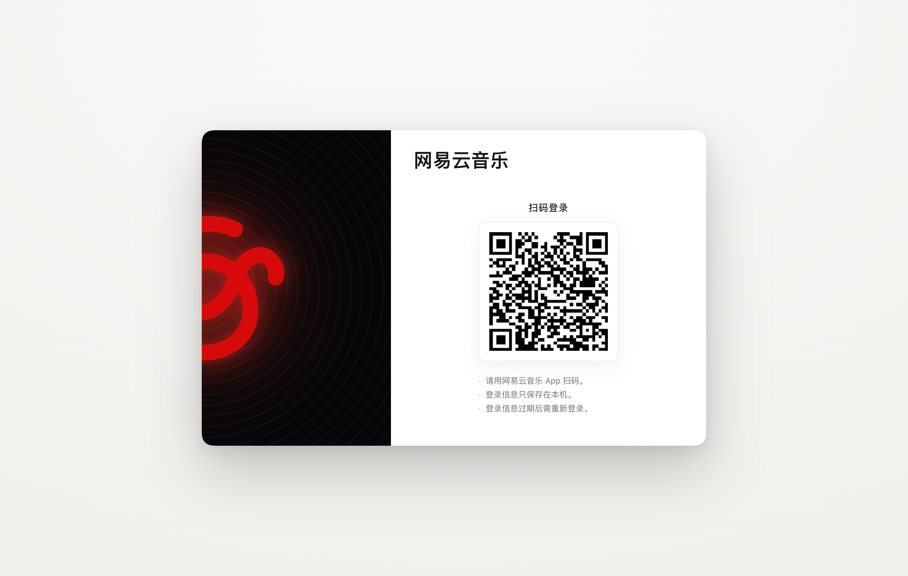

### 首页与我的

首页，右侧是页面切换，顶部是搜索框：

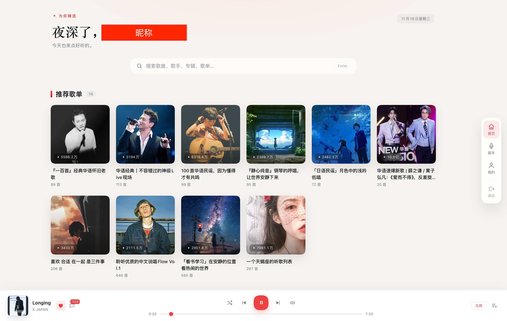

「我的」页，听歌数据与歌单：

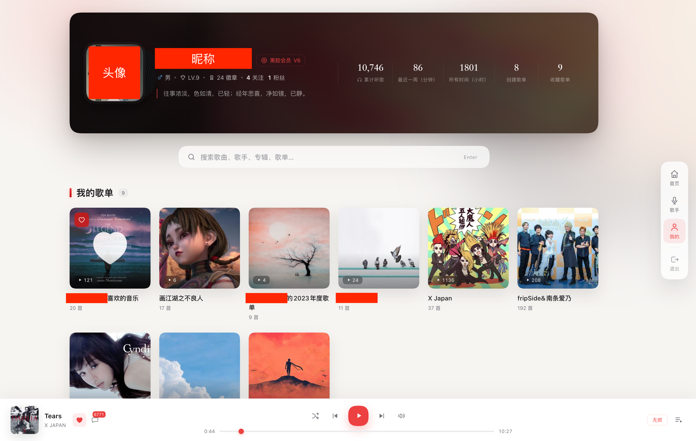

我的歌单：


关注列表：

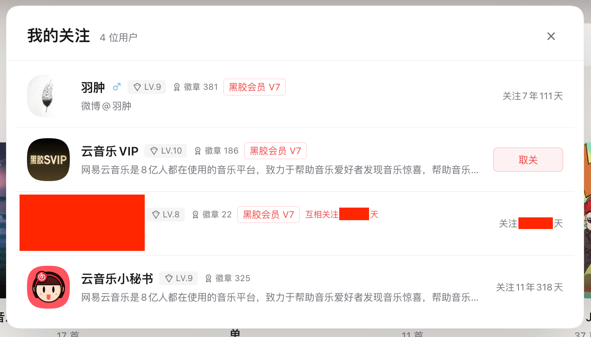

粉丝列表：

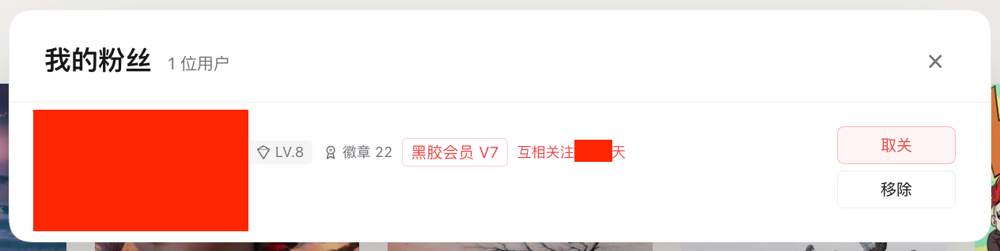

### 搜索

输入即搜，歌曲 / 歌手 / 歌单 / 专辑 / MV 聚合展示，点结果直接播放或打开详情：

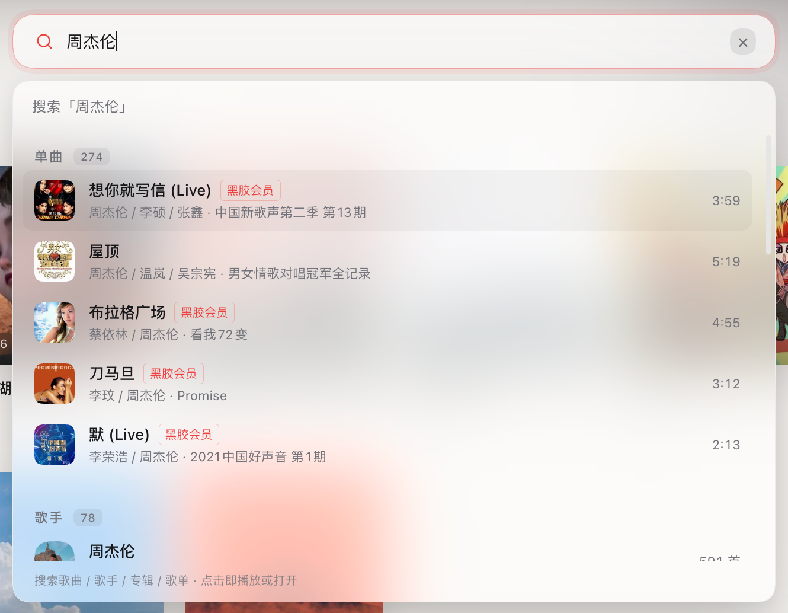

### 歌手与详情

歌手列表：

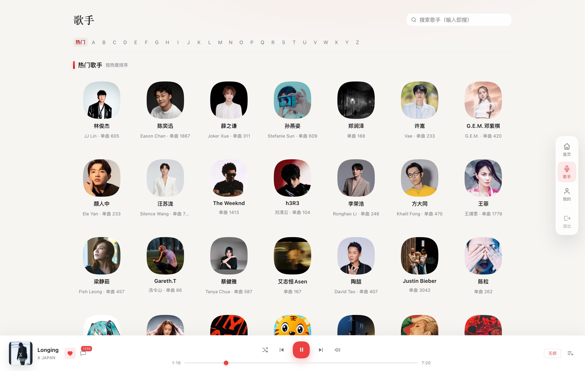

歌手详情 · 热门歌曲：

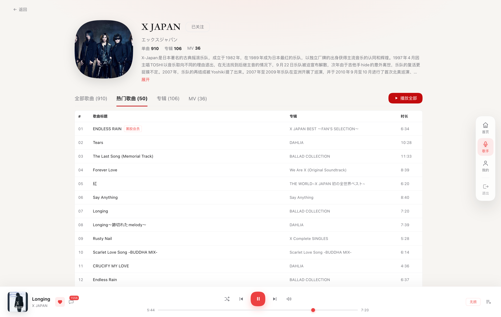

歌手详情 · 专辑：

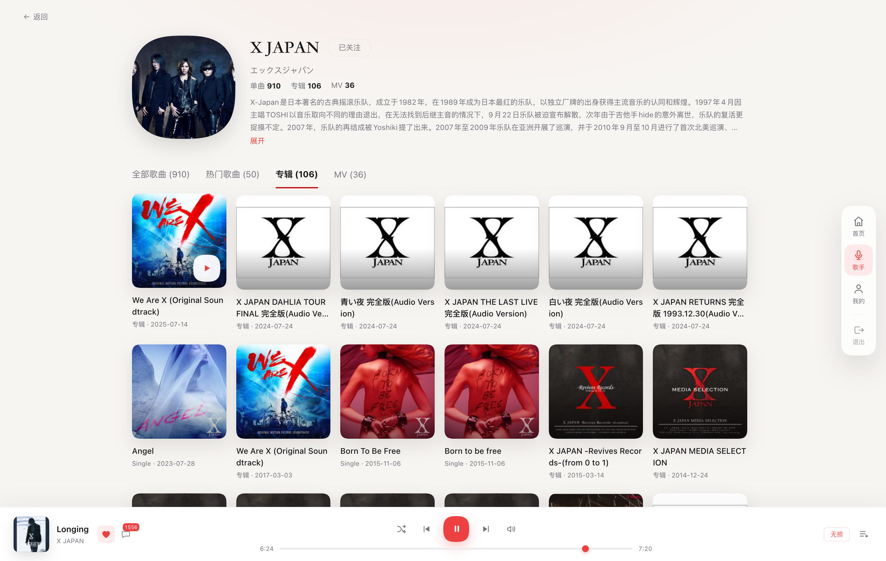

歌手详情 · 专辑弹窗：

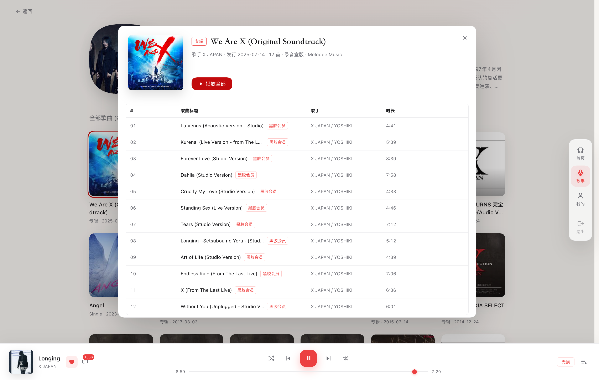

### MV

支持 MV 在线播放，可全屏、切换清晰度 / 倍速、调整音量。

歌手详情页的 MV 列表：

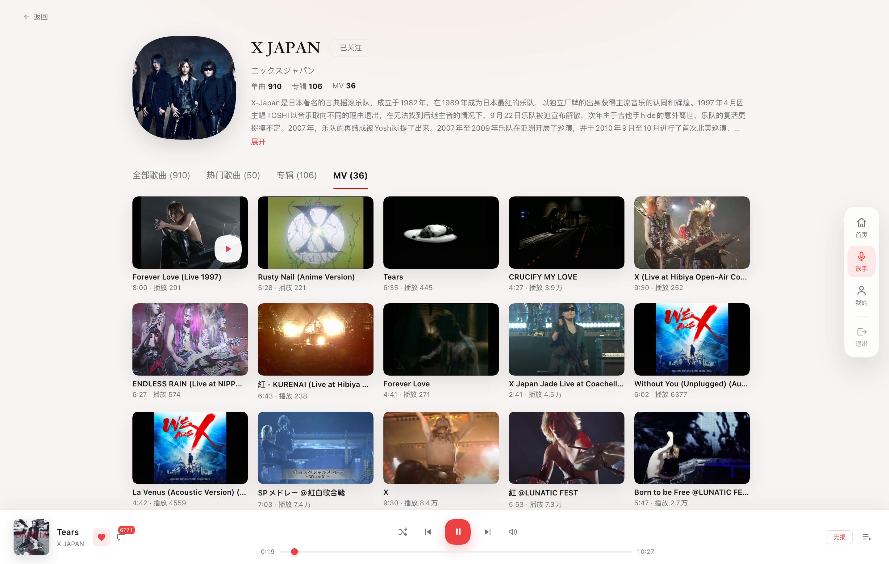

MV 播放：

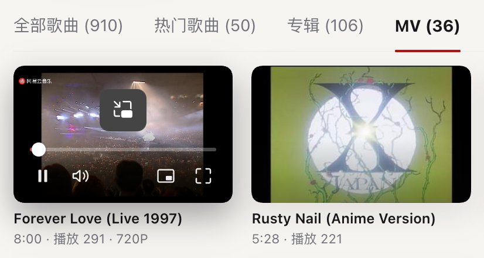

MV 播放音量调整：

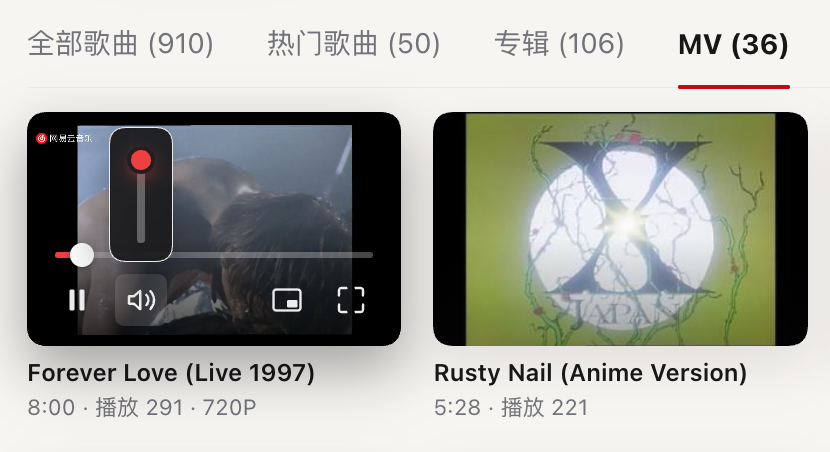

全屏播放与清晰度切换：

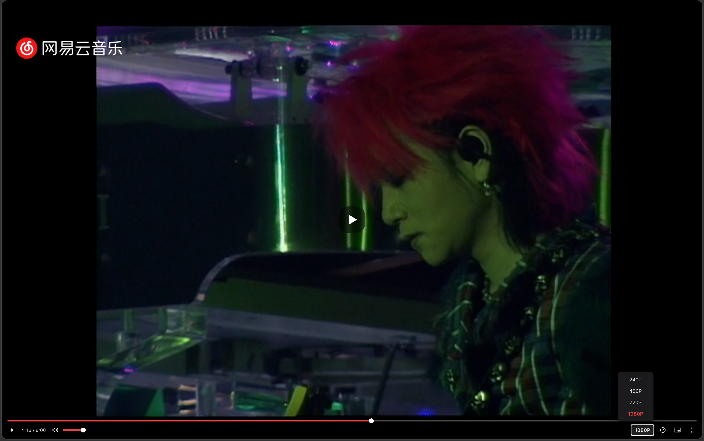

全屏播放速度切换：

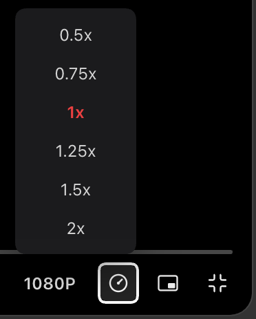

### 播放控制

播放队列：

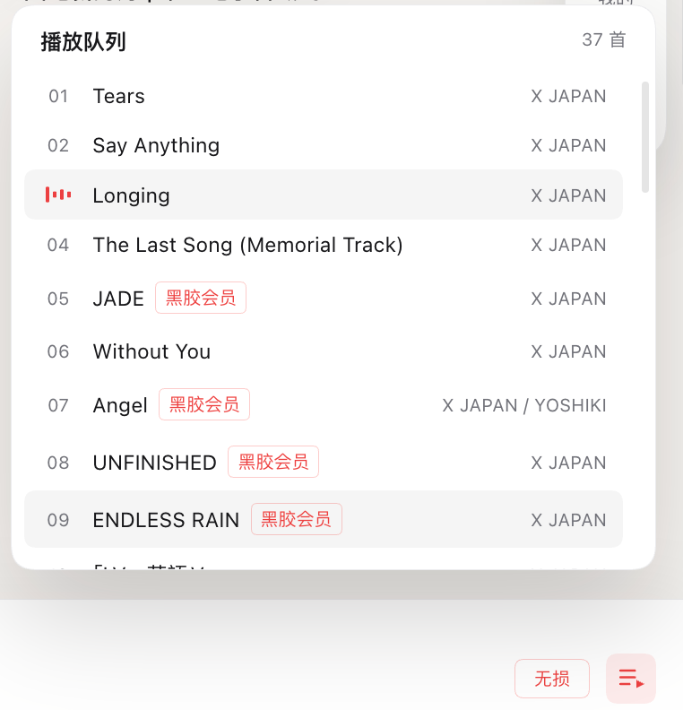

音质切换：

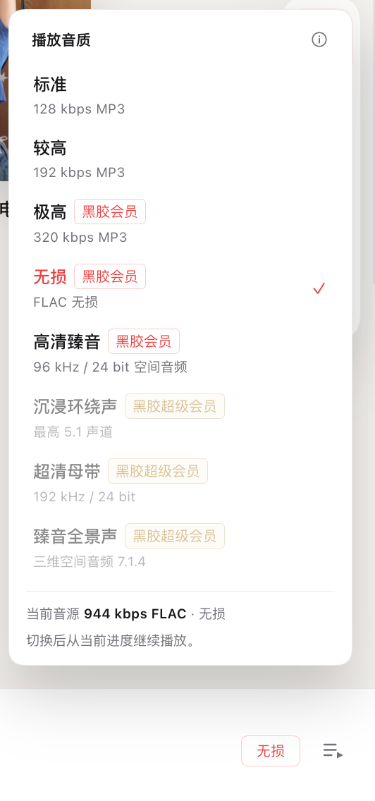

音量调整：

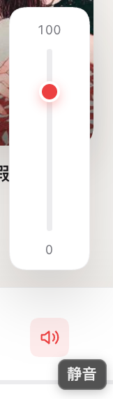

### 评论区

评论列表：

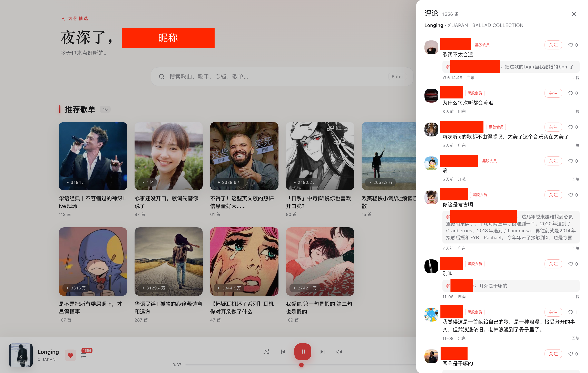

点赞 / 回复 / 关注：

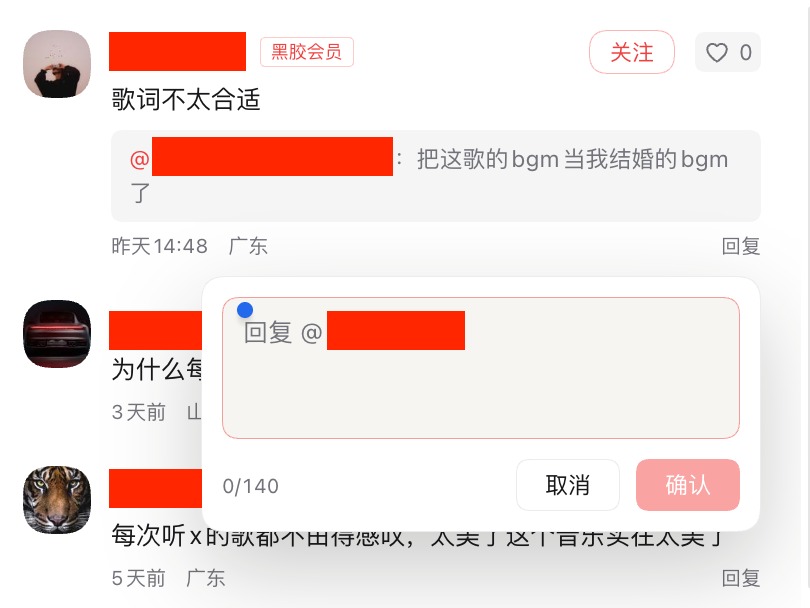

---

## 安装

### 环境要求

| 依赖 | 版本 |
|---|---|
| Node.js | `^22.19.0` 或 `>=24.0.0` |
| dsh | `>=0.2.0-rc.2` |
| dsh 配置 | 已配置好一个 profile（如 `web`） |

### 方式一：插件管理 / 命令行安装

在 dsh 左侧栏的 **插件** 页点「添加插件」，输入包名安装 `@dylanzbot/dsh-netease-music`；或在 profile 目录执行：

```bash
dsh plugin --profile web add --save-prod @dylanzbot/dsh-netease-music
```

装完后**刷新 dsh Web 页面**，左侧栏即可看到「网易云音乐」入口。若图标没出现，打开左侧栏的 **插件** 页，在 **已安装** 标签里确认 `@dylanzbot/dsh-netease-music` 已启用。

> **找不到「设置 → 插件」？** dsh 的插件管理入口是**左侧栏顶级的「插件」**（不是「设置」里）。设置里的「内置插件」只是只读清单，没有启用开关。

### 方式二：从源码本地安装（开发 / 自改）

克隆仓库并构建后，用内置脚本把产物装进本地 profile：

```bash
git clone https://github.com/dylanzbot/dsh-netease-music.git
cd dsh-netease-music
npm install
npm run build
bash scripts/link-profile.sh        # 默认装进 profile "web"
```

脚本会先执行 `dsh plugin add`，再把仓库最新的 `lib/` 同步进 profile 的插件目录（规避 pnpm `file:` 拷贝不刷新的问题）。安装后刷新页面即可；若侧栏没出现图标，到左侧栏 **插件 → 已安装** 确认 `@dylanzbot/dsh-netease-music` 已启用。

---

## 使用方式

1. **登录**：点开侧栏「网易云音乐」→「扫码登录」→ 用网易云音乐 App 扫码并在手机上确认。
2. **搜索**：顶部搜索框输入关键词，歌曲 / 歌手 / 歌单 / 专辑 / MV 输入即搜（300ms 防抖，回车立即搜）。
3. **播放**：点歌曲即可在底部播放栏播放，可切换音质、调整音量、管理播放队列、喜欢、切换循环模式。
4. **逛内容**：歌单、歌手、评论区都可以点进去查看；歌手页可关注 / 取关，MV 支持在线播放。
5. **设置**：插件自身的设置项在 dsh **设置页的「网易云音乐」分区**（独立的设置分区，不在「内置插件」里），可显示 / 隐藏关注粉丝数，或导出诊断日志（会自动隐去 Cookie 等敏感字段）。

> 若提示「登录暂不可用（8821）」，请稍后重试。这是上游服务端的限制，与插件无关。

---

## 隐私说明

- 登录凭证（Cookie）只保存在**宿主侧**，浏览器端拿不到明文。
- 所有对 `music.163.com` 的请求都由宿主代理发出，浏览器只访问同源的 `/api/ncm/*`。
- 诊断日志导出会自动隐去 Cookie 等敏感字段。

---

## 常见问题

**Q：侧栏没出现图标？**

到左侧栏的 **插件 → 已安装** 确认 `@dylanzbot/dsh-netease-music` 已启用，然后刷新页面；宿主侧改动需在该页禁用再启用（或重启 dsh）才会生效。

**Q：提示 8821 / 登录失败？**

上游返回的临时状态，稍后重试即可。

**Q：没有下载歌曲和显示歌词功能？**

确实没有，我个人觉得我既然在用DSH，我是用它来干活的，我不会长时间停留在网易云音乐页面，

---

## 开发

### 常用命令

```bash
npm install          # 安装依赖
npm run build        # 构建宿主 + 浏览器两半侧（产物在 lib/）
npm run dev          # 监听源码，浏览器侧改动即增量重建
npm run typecheck    # 类型检查（tsc --noEmit）
npm test             # 运行测试（vitest run）
npm run test:watch   # 监听模式跑测试
npm run test:coverage # 测试覆盖率
```

### 本地联调

```bash
npm run build
bash scripts/link-profile.sh [profile]   # profile 默认取 $DSH_PROFILE，否则 web
```

- 浏览器侧改动：`npm run dev` 会自动重建，刷新 dsh Web 页面即可看到。
- 宿主侧改动：`npm run dev` 只增量重建浏览器侧，宿主改动需重新 `npm run build`，再到左侧栏 **插件 → 已安装** 禁用再启用（或重启 dsh 进程）才会生效。

`link-profile.sh` 会自动识别 profile 里是 `link:` 软链（开发）还是 `file:` 拷贝（发布），分别处理 `lib/` 同步；可用 `DSH_HOME` / `DSH_BIN` 环境变量覆盖默认路径。

### 项目结构

```
dsh-netease-music/
├── package.json              # 包入口、exports、dsh 声明、scripts
├── cordis.patch.yml          # 宿主侧 bundle patch（插入插件 id）
├── icon.svg / locale/en.json # 插件图标与元信息（标题 / 描述）
├── scripts/
│   ├── build.mjs             # tsdown + @tsdown/css 双半侧构建
│   └── link-profile.sh       # 安装 + 同步 lib/ 到 profile
├── src/
│   ├── host/                 # 宿主半侧（Node）：注册 /api/ncm/* 路由，代理网易云接口
│   ├── client/               # 浏览器半侧（React）：侧栏图标、主面板、设置卡片
│   ├── constants/ types/ utils/  # 两端共享的常量、类型、工具
├── tests/                    # 测试
└── docs/                     # 架构 / FAQ / 接口说明
```

### 双半侧架构

dsh 原生插件分两半，通过包级契约关联：

- **宿主侧**：`src/host/index.ts`，跑在 dsh 主进程（Node），`inject: ['connection']`，把网易云接口封装成同源 `/api/ncm/*` 路由；产物 `lib/index.js` → `lib/host/index.js`（ESM）。
- **浏览器侧**：`src/client/index.ts`，跑在 dsh Web 壳子，注册侧栏 / 主面板 / 设置卡片到 dsh 的 slot；产物 `lib/client.js`（lazy-CJS factory，CSS 自动内联）。

浏览器 bundle 只能 `require` dsh 共享模块白名单里的模块（`react`、`react/jsx-runtime`、`react-dom`、`react-dom/client`、`@deepseek-ai/cordis`、`zod`），其余依赖需打包进 bundle。构建脚本已自动处理白名单、CSS 内联和类型产出，一般无需改动。

设计细节与踩坑记录见 [docs/](./docs/)（架构、FAQ、接口现状、MV 播放、多类型搜索等）。

---

## 关于

这是我个人**第一次开发 dsh 插件**，属于练手之作，并且我个人觉得功能也差不多了，**后续不会频繁更新**，注意力放在学习其他东西上。如果有想法或遇到问题，欢迎 fork 仓库自己动手改。

本项目在思路和实现上参考了[dsh-weread](https://github.com/zhaohongxuan/dsh-weread)项目，正是在它的启发下才有这个插件，在此表示感谢 🙏。

---

## 免责声明

- 本项目是**非官方**的个人学习与研究作品，与网易公司、杭州网易云音乐有限公司**没有任何关联、授权或背书**。文中及界面中出现的「网易云音乐」名称与标识，仅用于说明本插件所对接的服务，不构成对官方身份或合作关系的声明。
- 本项目**免费且非商业**：不收费、不含广告、不引流、不收集或上传用户数据。任何商业性使用均不在作者发布本项目的初衷之内。
- 本插件**不托管、不复制、不分发**任何音乐、MV、歌单等内容。所有请求都由你本机的 dsh 宿主使用**你自己的账号凭证**发出，内容直接来自上游服务。音乐与 MV 的著作权归各权利人及网易云音乐所有。
- 请使用**你自己合法持有的账号**，并自行遵守上游服务的相关协议及所在地法律。因使用本插件产生的任何后果由使用者自行承担。
- 若权利方认为本项目存在不当之处并联系作者，作者将**及时停止分发或移除相关功能**。

---

## License

[MIT](./LICENSE)
